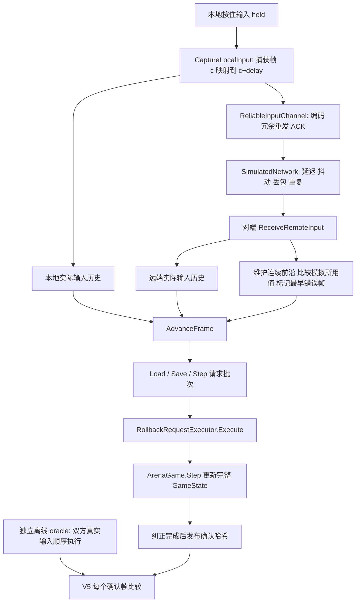

# S3：完整 RollbackSession 学习导读

2026-10-19 用户明确授权全部 S3 由 AI 实施，后续由用户人工验收。当前预测、纠正、停等与退休均已实现；本文件从实际运行顺序解释代码。历史学习步骤和失败数量见 verification 下的旧记录，当前证据见 [S3 完整验收](verification/s3-rollback.md)。

## 项目怎样运作



网络搬运真实输入；会话决定用什么输入、是否纠正；执行器保存/恢复并执行；S2 模拟只处理一步。会话不持有 GameState，网络不会替它决定确认或回滚。

## 先认清数据

| 代码中的实际名称 | 含义与为什么需要 |
| --- | --- |
| `NextFrameInternal` / `NextFrame` | 下一步要执行的输入帧。整批执行后等于 `GameState.Frame` |
| `LocalInputHistory` | 本地实际输入，按延迟映射后的目标帧保存。本地输入永不预测 |
| `RemoteInputHistory` | 收到的远端实际输入，可以乱序、有缺口；不存预测值 |
| `remoteUsedInputs` | 每帧模拟实际使用的远端值，可能是预测。迟到真实值要与它比较 |
| `RemoteContiguousInputFrameInternal` | 远端从 0 起连续实际输入的最后一帧，网络用来 ACK |
| `LastConfirmedInputFrameInternal` | 双方从 0 起连续实际输入齐全的最后一帧；仅收齐还不等于纠正已执行 |
| `pendingRollbackFrame` | 尚未处理的最早错预测帧；-1 表示无待纠正 |
| `earliestRetainedInputFrame` | 已实际退休后的输入下界，小于它的远端包只能忽略 |
| `deferredRetireBefore` | 上一完整请求批次决定的安全退休边界，下一次入口才应用 |
| `StatisticsInternal` | 累计回滚批次数、重模拟步数、未新增一步的调用数、最大回滚距离 |

这三种“进度”不能混为一谈：远端连续实际输入、双方连续实际输入、游戏已执行进度。收包时可以前两者领先，纠正批次结束后才可发布确认状态。

构造函数分配三份固定容量历史。延迟为 d 时，双方预先约定目标帧 `[0,d)` 为实际 None，因此两个连续前沿初始化为 `d-1`，但 `NextFrame` 仍为 0。d=0 时前沿为 -1。

## 按入口读代码

### 1. CaptureLocalInput：只登记一次延迟

捕获帧 c 的按住值登记到 c+d，返回这个目标帧供网络发送。相同帧相同实际值可重复提交，不同值报冲突。两个输入入口都更新双方确认前沿，因为可能先收到远端、后登记本地。

调用者在停等时不能重新采样同一捕获帧；同一逻辑帧只捕获一次。下一次新逻辑帧才读取新的按住值。按下沿由 S2 用完整快照里的 `PreviousInput` 计算。

### 2. ReceiveRemoteInput：区分实际冲突和预测错误

先应用上批安全退休边界，再检查保留窗口。已退休包返回 `IgnoredRetired`；过远未来帧在写槽之前报错，窗口右端不包含。

若该帧已有实际值，相同返回 `Duplicate`，不同报 `ConflictingInput`。若它已模拟过但此前没有实际值，就与 `remoteUsedInputs` 比较：不同才将 `pendingRollbackFrame` 更新为多个错误中的最早帧。随后登记实际值、推进远端连续前沿和双方连续前沿；遇到缺口立即停止。

未来帧的实际值只存起来，不能拿它预测更早的缺失帧。

### 3. AdvanceFrame：先纠正，再决定是否新增一步

1. 查看 `NextFrame` 对应的本地实际输入。没有就标记 `NoLocalInput`；有输入时，再看新增一步是否超过未确认预测窗口。
2. 算出整批需要的请求数，在写入之前检查容量。纠正距离 k 需要 `1+2k` 个请求，新增一步另需 2 个。
3. 若存在最早错帧 r，生成 `Load(r)`，按顺序重新生成 r 到旧 `NextFrame-1` 的 `Save/Step`。每帧优先使用远端实际值，缺失时重复**新时间线**前一帧所用的远端值。
4. 允许新增一步时再输出 `Save(NextFrame)`、`Step(NextFrame)`，并将 `NextFrame` 增加 1。否则只增加 Stalls；刚才的纠正请求依旧必须执行。
5. 排定安全退休边界，返回后由调用者立即执行整批。下一次入口才真正删除旧历史。

`MaxPredictionFrames=8` 时，只有拟推进后的领先 `(NextFrame+1)-(LastConfirmedInputFrame+1)` 不超过 8 才允许新增一步。即使当前帧远端实际值已到，更早的缺口仍占用窗口。

### 4. 一个具体纠正例子

假设延迟 0，本地 0～3 帧已登记；远端尚未到，已预测并执行 0～2 帧，所以 `NextFrame=3`。现在收到远端帧 1 的 Right，与当时使用的 None 不同：

```text
ReceiveRemoteInput(1, Right) → pendingRollbackFrame = 1
AdvanceFrame → Load(1)
               Save(1), Step(1, 远端 Right, 重模拟)
               Save(2), Step(2, 远端 Right, 重模拟)
               Save(3), Step(3, 远端 Right, 新增)
执行完整批次后 → GameState.Frame = NextFrame = 4
```

帧 2 缺少实际值，重复的是纠正后的帧 1 的 Right。若没有本地帧 3，只输出前面的纠正部分，帧号仍为 3，返回 `NoLocalInput`。

### 5. 为什么退休要延后

连续收包可能快速推进双方确认前沿，但旧预测还没有纠正。此时立即按新前沿丢历史，会删掉重模拟仍需的本地输入。

因此 `AdvanceFrame` 整批生成后，只安排 `max(0, min(LastConfirmedInputFrame, NextFrame-1))` 作为退休下界；下一次入口意味着调用者已经执行完这一批，再删除更早的记录。保留最后一个已确认且已执行的输入，也为未来预测留住前驱值。

执行器独立保留快照/哈希。harness 在完整执行纠正并发布确认日志后才调用执行器的 `RetireBefore`。不能把 Session 的输入退休和网络 ACK 释放重发缓冲混为一件事。

## 自己运行与观察

```sh
.ai/verify.sh
# 默认：734 项 .NET（含快速 V5 16 seeds）+16 项 Python，无分类排除

dotnet test RollbackArena.sln -c Release --filter 'FullyQualifiedName~RollbackSessionContractTests|FullyQualifiedName~RollbackSessionEdgeTests'
bash tools/verify_v5.sh
# 完整 1000 seeds，独立核对真实 TRX

dotnet run --project tools/headless -c Release -- --sync-test --distance 8
dotnet run --project tools/headless -c Release -- --rollback-bots --seed 0
```

推荐阅读顺序：`RollbackContracts.cs` → `RollbackSession.cs` → `RollbackRequestExecutor.cs` → `RollbackEquivalenceRunner.cs`。环形容器和网络可靠性可第二遍再看。

读完应能回答：为什么 C 已推进仍不能马上退休？为什么 `NoLocalInput` 仍可能有 Load/Step？若先到远端帧 10，能否用它预测缺失的帧 8？

下一阶段是 [S4 Unity 表现层方案](specs/0005-s4-unity.md)，当前等待方案审批和可用 Editor。Unity Mono / IL2CPP / WebGL、性能浸泡与手感均未凭 S3 .NET 检查自动获得证明。
