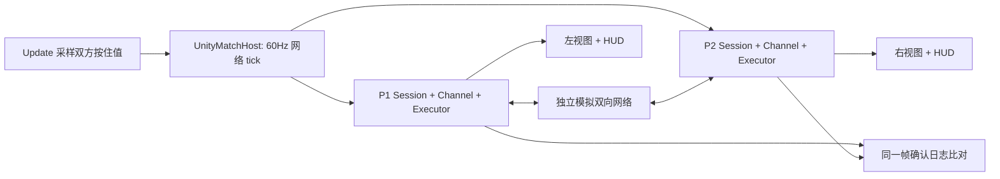

# 方案：S4 Unity 表现层与本机模拟网络对战

> 状态：**用户已批准，进入 A 环境与程序集阶段**（2026-10-19）。S3 已完成本机 .NET 验收，当前先验证远端 CI 与 Editor 环境。

## 已批准的决定

采用 Unity **6.3 LTS** 系列、Built-in 3D 简单几何体，工程放在 `unity/RollbackArena`。先完成本机键盘双人、两个独立对端并排显示，以及 **150 ms 单向基础延迟（9 ticks，约 300 ms 基础 RTT）**；网络参数在开局前选择，修改后明确重开整场。

本机常规安装目录未找到可用 Editor：Hub 存在，旧 Unity.app 链接指向不存在的版本。本阶段开始前需确认可用 Editor 的实际路径和版本；首次成功安装/导入后将具体 `6000.3.xf1` 固定到 `ProjectVersion.txt`，不能假定仅有 Hub 就可执行测试。批准方案不等于声称环境已就绪。

## 目标

玩家能在 Unity Editor 里用同一键盘打完一场 S2 规则的 1v1 对战。左右视图分别来自独立 RollbackSession，经模拟网络交换输入；HUD 展示帧号、连续确认进度、回滚统计和停等原因。回滚只影响显示平滑，不改变确定性游戏状态。相同回放在 .NET 与 Unity Mono 中逐帧哈希完全相同，最后进行一次人工试玩。

总方案 S4 的完成标准：模拟 150 ms 延迟下完整一场、统计可见、V6 Mono 部分通过、V9 人工试玩通过。

## 不做

- S5 的真实 socket/WebSocket、房间、远程匹配、WebGL 发布与 IL2CPP 比对。
- 新玩法、角色模型/动作资产、复杂特效、镜头系统、商店或账号。
- 用 Rigidbody、Unity Physics、Transform、Animator 或 Unity 时间参与 Sim/Rollback 计算。
- 为了“更平滑”改 Fixed64、S2 数值、回滚算法或将预测哈希当作确认哈希。
- 本阶段只读性能采样，不据此宣称 V7 全预算或 V8 长时浸泡完成。

## 背景与现状

`Arena.Sim`、`Arena.Rollback`、`Arena.Net` 均是 C# 9 / netstandard2.1，无外部包。S3 已有完整会话、请求执行器、可靠输入通道和显式 tick 的模拟网络；`tools/headless/RollbackEquivalenceRunner.cs` 提供双端与独立 oracle 的参考执行顺序，不能让 Unity 运行时引用 net9.0 headless 工程。

当前没有 Unity 工程、asmdef、场景或 Unity 测试。Mono / IL2CPP / WebGL 的结果尚未产生，纯 .NET 成功不能代替 V6。

Unity 官方支持将外部编译的 .NET DLL 作为 [managed plug-ins](https://docs.unity3d.com/6000.3/Documentation/Manual/plug-ins-managed.html)，但同时要求实际验证编译器兼容性。因此先做最小导入及完整回放比较，再写表现层。API Compatibility Level 选 [.NET Standard 2.1](https://docs.unity3d.com/6000.3/Documentation/Manual/dotnet-profile-support.html)。版本系列依据 [Unity 6 支持政策](https://unity.com/releases/unity-6/support) 选择 6.3 LTS，具体补丁需安装后锁定，不以文档推断本机可用版本。

## 设计

### 目录与程序集交付

```text
src/Arena.Sim / Arena.Rollback / Arena.Net    唯一核心源码
    dotnet Release build
    tools/export_unity_core.sh              待实施：导出并核对三份 DLL 哈希
unity/RollbackArena/
    Assets/Plugins/Arena/                   派生 DLL，忽略二进制，导出脚本生成
    Assets/Arena/Runtime/                   Arena.Unity asmdef、桥接和显示
    Assets/Arena/Editor/                    Editor 建场景及验收入口
    Assets/Arena/Tests/Editor/              Unity EditMode 测试
    Assets/Arena/Scenes/Arena.unity
    Packages/manifest.json + packages-lock.json
    ProjectSettings/ProjectVersion.txt
```

提交 Unity 文本资源及稳定 `.meta`；忽略 Library/Temp/Logs/Obj/UserSettings/导出结果与派生 DLL，保留 DLL 的稳定 `.meta`。导出时重新构建，写入源版本/DLL SHA256 清单；Editor 测试入口先核对清单与实际导入文件，拒绝缺失或旧 DLL。干净检出需要先执行导出脚本，再启动 Editor。导出脚本不得修改 `src`，不手动维护第二份核心源码。

**考虑过但没选：**直接复制 C# 源码会产生两份真源；本地 UPM 包也可行，但当前只需三个稳定程序集，DLL 导出最小且可用哈希证明测试对象一致。选 Built-in 以减少首个可玩版本的渲染配置；此阶段不需要 URP 功能。

### 模拟与显示的边界



`Update` 只在 Unity 层累计 `Time.unscaledDeltaTime`。每满 1/60 秒推进一个网络 tick，单次 Update 最多追赶 8 ticks，超额保留积压并在 HUD 显示，不能跳过游戏帧或丢弃 tick。失焦时暂停整个本机实验（双方和网络一起暂停），恢复时不补失焦期间的时间；不引入线程或并发时序。

每个 tick 顺序固定：

1. 网络 `AdvanceTo(tick)`；每端只为新的 `session.NextFrame` 捕获一次本地 held，返回目标帧送入自己的通道。停等重试不重新捕获。
2. 双方先发送，再双方接收并登记远端输入，维持零延迟时的对称性。ACK/重发在停等时照常执行。
3. 每端清空请求缓冲、调用 `AdvanceFrame`、**无论是否 ForwardAdvanced 都完整执行请求**；然后核对 `GameState.Frame == NextFrame`。
4. 完整纠正批次后，仅发布到 `min(NextFrame, LastConfirmedInputFrame+1)` 的新确认哈希。双端同帧比较；保留发布前状态以导出去同步差异，发布/比较完成后退休执行器历史。日志使用有界环槽，慢端超出容量显式报错。
5. 更新显示状态和统计；游戏预测进入 MatchOver 时仍继续处理网络和纠正。双方终局确认一致后显示最终比分，按钮显式重开新 session/network。

`UnityMatchHost` 只编排现有入口，不复制预测策略。其 Editor 测试用逐 tick 输入 tape，与 headless oracle 对比；模式按钮调用同一个 host。可以换本地输入来源（键盘/录制机器人）而不改变回滚行为。核心异常时停止该场并保留诊断，不吞错继续显示过期画面。

### 操作与视图

- P1：WASD 移动，Space 跳跃，J 攻击，K 闪避；P2：方向键移动，RightShift 跳跃，Keypad1 攻击，Keypad2 闪避。HUD 始终显示映射；无小键盘可在开局设置第二组按键。
- 使用旧 Input Manager 的 KeyCode 按住查询，仅在 Unity 层生成 PlayerInput；无需新增 Input System 包。按下沿由模拟 PreviousInput 决定。
- 两个相同擂台并排渲染，各自只读自己的 Executor.State。统一俯视斜角相机，玩家以不同颜色胶囊表示，姿态/颜色显示动作、硬直、无敌；地面与边界尺寸来自 S2 常量，HUD 展示阶段、倒计时、比分及双方 HitCount（累计受击次数）。
- 核心 X/Z/Y 定点值只在显示边界转为 Unity Vector3。平滑维护显示偏移：逻辑位置立即更新，发生纠正时保留上一显示位置的偏移，再按显示时间衰减；大距离、开局和重开时直接对齐。关闭平滑能直接观察跳变，平滑数据绝不写回 GameState。攻击与命中事件表现暂只读当前状态，不因重模拟重复播声音/生成物件。
- HUD 分端展示 NextFrame、LastConfirmedInputFrame、RemoteContiguousInputFrame、rollbacks/resimulated/stalls/maxDistance、最后停等原因、网络 tick、参数和 dropped/duplicated；单向延迟与 RTT 用明确文字标注。

### 网络设置

开局预设 0 / 50 / 100 / 150 / 200 ms 单向延迟，对应整数 ticks 0/3/6/9/12；另选 jitter 0～3 ticks、丢包 0～10%，整数百分比转换为 permille。固定 seed 可编辑/显示。默认验收预设为双向各9ticks、无抖动/丢包，另跑9ticks+3jitter+10%loss。

`NetworkConditions` 是创建时固定值，不做中途变参。界面“应用并重开”新建两端、网络和显示状态，不能悄悄保留旧包/旧 ACK。150 ms 延迟高于8帧预测窗，停等可能出现，这是预期，应由实际试玩决定后续手感调整。

### V6 Mono 与桥接验收

生成并保存同一输入 CSV、初始状态/seed、H(0) 及每步 H(F) 的参考文件。Unity EditMode 用导入 DLL 顺序执行这份输入，输出完整帧号/哈希；外部比较器核对行数、帧号及每行值，不只比较最终 hash。至少覆盖 S2完整机器人场与 S3 三类输入（delay=0/2/4，对应独立映射的预录 tape）。

桥接测试另运行双端 host，持续到所有实际输入确认且尾部纠正完成；确保“预测终局”不会提前退出。故意篡改导入 DLL 清单、跳过 host 的停等纠正批次、破坏一个 Mono 哈希输出，相关检查分别必须失败，再恢复并重新运行。

计划新增命令（目前尚不存在，不能作为已经通过的证据）：

```sh
bash tools/export_unity_core.sh
bash tools/verify_unity_mono.sh "$UNITY_EDITOR"
```

脚本将调用实际 Editor：`-batchmode -nographics -projectPath unity/RollbackArena -runTests -testPlatform EditMode -testResults <fresh-results.xml> -logFile <fresh-editor.log>`，核对非零用例和结果。统一 Unity 版本后固定 Test Framework 兼容版本及包锁文件；不能因本机缺编辑器让命令假绿。CI 接入需另有 Editor/许可证环境，暂不承诺已可自动运行。

## 分阶段

| 阶段 | 内容 | 完成标准（done-when） | 验证命令 |
| --- | --- | --- | --- |
| A 环境与程序集 | 固定 Editor 补丁、最小工程、DLL 导出、EditMode fixture | 新目录导出后 Editor 无编译错误，导入 DLL 清单吻合；Unity 顺序回放与 .NET 逐帧完全一致，负探针抓错 | `.ai/verify.sh`；上述两条计划命令 |
| B 双端桥接 | 固定 tick host、停等/纠正、终局确认、重开 | delay 0/9ticks、loss 0/10% 与不同显示刷新调度下，确认日志逐帧等于 oracle；停等仍收发；原 S3 全绿 | EditMode host tests；`bash tools/verify_v5.sh` |
| C 可玩场景 | 双视图、控制、只读平滑、HUD、开局网络设置 | Play Mode 可见两个独立端，按键可操作；开关平滑不改确认哈希；应用设置清空旧场；错误能导出诊断 | Editor 测试 + 截图/实际操作 |
| D 人工验收 | 150ms 单向完整一场、扰动预设一场、性能采样 | 用户确认操作和纠正可接受，比分两端一致；保存参数/seed/确认hash/统计/Profiler证据；V6 Mono 全量日志通过 | 人工 V9 + V6 比较脚本；最终 `.ai/verify.sh` |

## 质疑

- **最弱假设：150 ms 的意思。** 本草稿按单向解释；如果用户原意为 RTT，需要把两方向设置改为总 RTT 约150ms，并记录60Hz量化误差。这是审批时最重要的语义决定。
- **环境风险已实际预检。** 当前常用目录只有 Hub/失效 Editor 链接，无法运行 Mono。Editor 安装、许可证与首次包导入必须产生真实日志，不能用手写 Unity stubs 替代验证。
- **键盘同时按键限制。** 单键盘可能键位冲突或缺小键盘；首轮试玩检查多键组合，必要时换映射。手柄与重绑定完整 UI 留后续。
- **DLL陈旧。** 导出清单及 fresh build 是必要条件；若不验证 Unity 实际加载版本，V6 可能比较了旧程序。每次验收记录实际 DLL 哈希。
- **显示掩盖错误。** 并排视图和关闭平滑用于观察差异；正确性仍由确认哈希证明，不能仅凭看起来顺畅通过。
- **更新循环风险。** 追赶上限只能延缓处理，不能丢 tick；性能差时 HUD 要暴露积压。网络不停等与逻辑停等分离由 host 测试验证。
- **回退路径。** S4 只新增 unity/ 与工具；S3 CLI 和全部 .NET 测试保持独立可运行。若 Editor 阻塞，可停留在已验收 S3；不切分支/reset/删除已有工作来回退。

## 进展记录

- 2026-10-19：S3 完成后拟定草稿，已调查现有调用边界与本机 Editor 可用性，并核对 Unity 官方程序集/兼容性文档。未创建 Unity 生产代码，等待具体方案批准与可用 Editor；未执行 Unity/Mono/IL2CPP/WebGL 或人工试玩。用时/费用未精确统计。

- 2026-10-19：用户批准本方案，并授权提交/推送 S3 验证远端 CI；先准备环境与 Mono 回放，尚未证明 Editor 可用。
